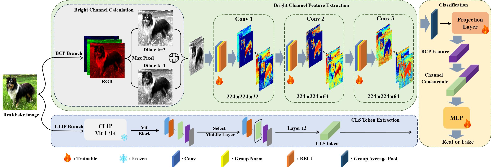

## CLIP-BCP: Generalizable AI-Generated Image Detection via CLIP Mid-layer Representations and Bright Channel Prior



### Dependencies

```bash
pip install -r requirements.txt
```

### Download CLIP pre-trained model

Download the CLIP model from [Hugging Face](https://huggingface.co/openai/clip-vit-large-patch14).

### Dataset

- Train Dataset:[CNNDetection](https://github.com/peterwang512/CNNDetection)
- AIGCDetect-Benchmark:[PatchCraft](https://fdmas.github.io/AIGCDetect/)
- Genimage:[Genimage]()

### Train

After downloading the dataset, modify the dataset format and directory, and then use the following code for training:

```bash
# AIGCDetect-Benchmark
python train.py --train_dir ./CNNDetection/progan_train  --val_dir ./AIGCDetectionBenchmark/ --clip_model_path ./clip-vit-large-patch14  --max_samples 9000

#Geniamge
python train.py --train_dir ./Genimage/train/  --val_dir ./Genimage/val/ --clip_model_path ./clip-vit-large-patch14  --max_samples 1000
```


### Checkpoint Download

AIGCDetect-Benchmark:

[https://drive.google.com/file/d/1Dz_LexOdjmEQrfDlEduSrvBhS6jGDtSB/view?usp=sharing]()

Genimage:

[https://drive.google.com/file/d/16hxN8UhRzYkxBtGeTIbLc6aQxOVTY7dv/view?usp=sharing]()

Use checkpoints for testing:

```
# AIGCDetect-Benchmark
python test.py  --test_dir ./AIGCDetectionBenchmark/ --clip_model_path ./clip-vit-large-patch14   --checkpoint_path ./best_model_AIGCDetect.pth

# Genimage
python test.py  --test_dir ./Genimage/val/ --clip_model_path ./clip-vit-large-patch14  --checkpoint_path ./best_model_Genimage.pth
```
